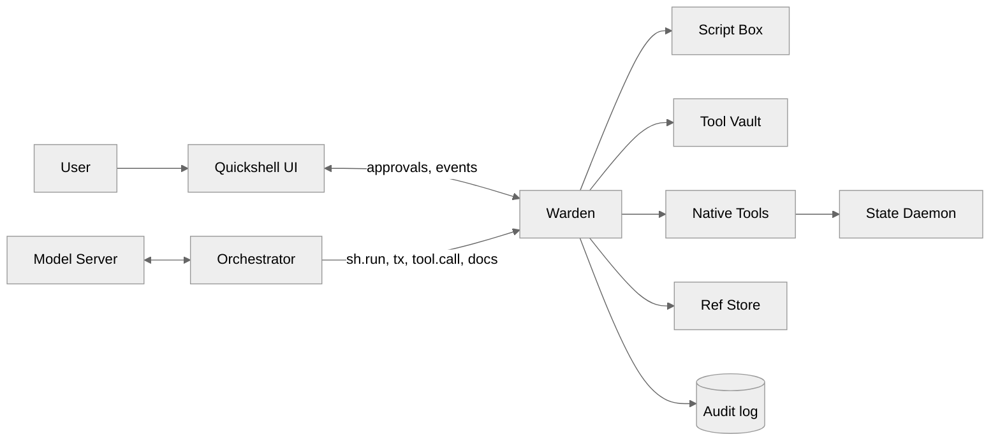

# Architecture

Up: [[Home]]

> **Summary:** The components, their trust levels, who owns what, and how they talk. The warden is tiny and trusted and enforces everything. The orchestrator is untrusted and runs the agent loop. The model acts only through `sh(script)` in a script box or through native tool calls.

## Components
| Component | Role | Trust |
|---|---|---|
| [[Warden]] | Policy, grants, spawns every box, effects and diff, snapshots, audit, session tokens, serves the tool vault | **Trusted**, tiny Go. Never calls the model. Never parses script text or model prose |
| [[Orchestrator]] | Model I/O, context, history, doc retrieval and injection, agent loop, browse and act sessions | **Untrusted**, sandboxed as the `fios-agent` user. Disposable |
| [[Script Box]] | Runs the model's bash in an allowlisted rootfs (read-only in v1, copy-on-write clone later), no network | Untrusted, spawned and configured only by the warden |
| [[Tool Vault]] | Manifests and docs (L0 index, L1 card, L2 full) for native tools | Trusted content: root-owned, read-only, hashed bundle |
| [[Approval UI]] | Quickshell popup for human approval. A client of the warden | Runs as the desktop uid. Approval authenticity is an open issue (below) |
| [[State Daemon]] | Live cache of windows, workspaces, notifications | Read-only |
| [[Toolbox]] | Native command stubs that call the warden, plus the allowlisted rootfs of standard bash tools | Class applies to native tools and effects, not to every wrapped binary |
| [[Ref Store]] | Large outputs saved as handles | Warden-owned files |
| [[Sentinel]] | Counts actions, trips a circuit breaker. Never reads model text | Part of the warden |
| [[Model Server]] | Local inference (llama.cpp or similar) | Unprivileged, no network |

## Diagram


## Who owns what
| Concern | Owner |
|---|---|
| Policy, grants, approvals | Warden |
| Executing actions, snapshots, effects, apply | Warden |
| Audit log | Warden |
| Tool docs (source of truth) | Tool Vault, served by the warden |
| Script execution | Script Box, spawned by the warden |
| Conversation history | Orchestrator |
| Context assembly and compaction | Orchestrator |
| Doc ranking and injection | Orchestrator |
| Inference | Model Server |

## Sessions and capability tokens
- One model, several sessions with different permissions. See [[ADR-0001 Single Model]].
- The warden issues a token per session.
  - **Browse token:** `web.*`, `ref.*`, docs. Cannot call `sh` or `tx`.
  - **Act token:** `sh`, `tx`, `tool.call`. No web access.
- Even if injected text makes the browse context emit an `sh` call, the warden rejects it.
- Cross-session data moves only as typed artifacts through the warden, marked untrusted.

## Transport rules
- Unix sockets, JSON lines, versioned framing, size and rate limits. See [[Protocol]].
- The warden identifies callers by `SO_PEERCRED`, never by what a message claims.
- Every call carries a session token that the warden checks.
- Approvals travel on a separate socket between the UI and the warden, never through the orchestrator.
- The orchestrator imports nothing from the warden's internals.
- UI events from the orchestrator are untrusted display text. They must look different from real approval prompts.

## Warden internals (Go packages)
- `proto`: socket server, peer credentials, framing, limits
- `identity`: uid and executable to principal
- `policy`, `grants`: classes, scopes, `policy.toml`, once, session, always, expiry, revoke on restart
- `box`: sandbox interface, bubblewrap implementation, allowlisted rootfs, clones, transactions
- `effects`: diff clone against base, plan objects, hash, apply
- `snapshot`: btrfs snapshot before every apply
- `registry`: serves the static docs bundle and native command stubs
- `refstore`, `audit` (write-ahead, hash-chained), `sentinel`, `approval` (bound to plan hash)

## Orchestrator internals
- `modelclient`: streaming, stop conditions, constrained decoding
- `context`: stable prefix (rules plus L0 index), summary, recent turns, injected docs, token accounting
- `history`: append-only conversation log, compaction
- `docs`: bundle loader, BM25 ranking first, injection policy and working set
- `loop`: observe, decide, act, read result, stop or retry, with step and retry limits
- `lint`: advisory bash lint with one-line fixes
- `sessions`: browse and act
- `router` (later): fast path for trivial commands

## Failure behavior
| Failure | Result |
|---|---|
| Warden down | Orchestrator can do nothing and halts |
| Orchestrator crash | Warden revokes its session grants and kills its boxes |
| Audit write fails | Deny everything (fail closed) |
| Approval timeout | Deny |
| Real files changed before commit | 3-way check, abort on conflict |
| Model server crash | Orchestrator reports an error and retries within limits |

## Repo layout (planned)
```
fios/
  cmd/warden/        internal/{proto,identity,policy,grants,box,effects,
                               snapshot,registry,refstore,audit,sentinel,approval}
  cmd/orchestrator/  internal/{modelclient,context,history,docs,loop,lint,sessions}
  vault/             manifest.toml + doc.md per native tool
  rootfs/            allowlist definition for the script box
```

## Open issues
- **Bash in a box:** proposed as the native language, awaiting confirmation. Needs an ADR.
- **Warden privileges:** v0 as root with systemd hardening, privileged helper later.
- **Orchestrator language:** Go to start, JSONL keeps Python possible.
- **Clone mechanism:** btrfs reflink or bubblewrap overlay.
- **Approval authenticity:** anything running as your uid looks like the UI. Candidate defenses: executable path and hash check via `/proc`, compositor-level overlay. Unverified.

## Map

- [[Warden]]: The trusted reference monitor. Decide, execute, log. Nothing else.
- [[Orchestrator]]: The untrusted agent loop. Where model failures and injection can happen.
- [[Script Box]]: Where the model's bash actually runs, on a throwaway clone.
- [[Tool Vault]]: Trusted, read-only tool docs and manifests.
- [[Approval UI]]: The human-in-the-loop surface, a Quickshell popup.
- [[State Daemon]]: Cheap, always-fresh knowledge of the desktop so the model never polls.
- [[Toolbox]]: Native command stubs and the allowlisted rootfs.
- [[Ref Store]]: Handles for large outputs so context stays small.
- [[Sentinel]]: Action counter and circuit breaker.
- [[Model Server]]: Local inference process, unprivileged and offline.

## Related
- [[Security]]
- [[Execution]]
- [[Invariants]]