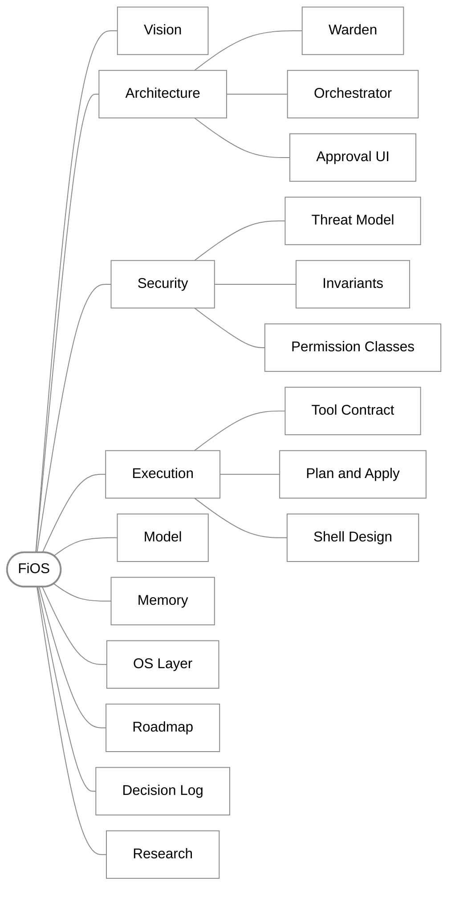

# Home

> **Summary:** Root of the mind map. Start here.

**FiOS (FRIDAY Integrated Operating System)** is a long-term plan for a minimal, clean, security-first Arch-based distro for developers, with a local AI assistant (the model is called **FRIDAY**) that maintains the PC, runs a light voice assistant, automates debugging to a limited level, and does web search and research, all locally.

## Start here (low-energy path)
1. Open [[Now Next Later]] and look at **NOW only**.
2. New idea or worry? Put it in [[Parking Lot]]. Do not act on it yet.
3. Lost or returning after a break? Open [[Where Was I]].
4. Not sure how this vault works? [[How to Use This Vault]].

## Mind map

## How the branches relate
- [[Vision]] says *why* and *what is out of scope*.
- [[Architecture]] says *what the parts are*.
- [[Security]] says *what must never happen* and how the OS enforces it.
- [[Execution]] says *how the model's actions actually run*.
- [[Model]] and [[Memory]] are research tracks that plug into the above.
- [[OS Layer]] covers Arch Linux, the desktop, rollback, and distribution.
- [[Roadmap]] says *in what order*, with an exit test per step.
- [[Decision Log]] records *what was decided and why*.
- [[Research]] holds sources and open questions.

## Map

- [[How to Use This Vault]]: Working rules that keep the vault useful instead of becoming another chore.
- [[Now Next Later]]: The only task list. Keep NOW tiny.
- [[Parking Lot]]: Inbox for ideas and worries. Capture in one line, triage weekly.
- [[Where Was I]]: Re-entry note. Update at the end of every session.
- [[Glossary]]: Project vocabulary in one place.
- [[Vision]]: Why FiOS exists, who it is for, and what it will do.
- [[Architecture]]: The components, their trust levels, and how they talk.
- [[Security]]: What must never happen, and how the OS enforces it.
- [[Execution]]: How the model's actions actually run, safely and cheaply.
- [[Model]]: Model research track. Owned personally by the author; results land here.
- [[Memory]]: Long-running context and recall. Deferred until OS, tools, and model are settled.
- [[OS Layer]]: The base system: Arch Linux, the desktop, rollback, distribution, and hardware.
- [[Roadmap]]: The order of work, with an exit test at every step.
- [[Decision Log]]: Index of architecture decision records (ADRs).
- [[Research]]: Sources and open questions. Facts with provenance live here.
